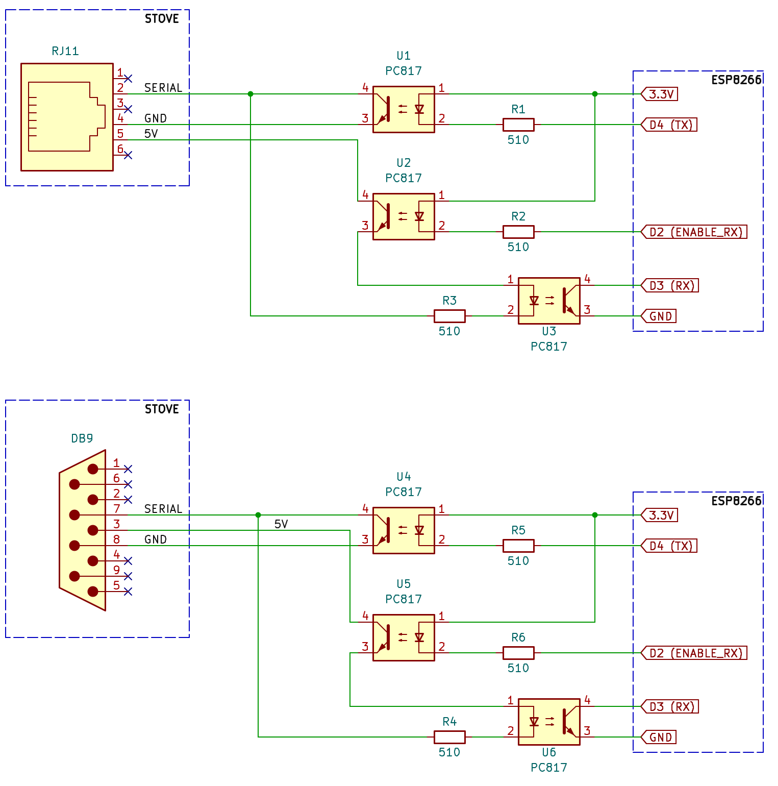

# Pellet Stove Control  

<a href="https://buymeacoffee.com/fabrizioroz" target="_blank">
  
</a>

**I have prebuilt kits, ask me if you need any information!**

This project lets you smart control any pellet stove driven by a Micronova N100 controller, through MQTT (Home Assistant, openHAB, ...).
The firmware is an Arduino sketch for the ESP8266, tested on a Wemos D1 mini (the board the PCB is designed for) connected to a Micronova N100 controller.
It also builds for the ESP32 (see [Circuit diagram](#circuit-diagram) for the pins), but it has not been tested on ESP32 hardware.
Other Micronova boards could work too, but this is left to the user/developer (the memory mapping may change).

Repository content:
- [`Pellet-Stove-Control.ino`](Pellet-Stove-Control.ino): the firmware.
- [`docs/micronova_stove_commands_mapping.xlsx`](docs/micronova_stove_commands_mapping.xlsx): registers, command frames and stove states.
- [`PCB/`](PCB): schematic and KiCad project of the interface board.

## The Pellet Stove Control works with
the following pellet stoves (please ask me before to check if this could work with your
pellet stove!).
<details>
<summary><b>Compatible pellet stoves</b></summary>

- AMG S.p.A. (Artel, Kalor, Tepor, Foco, Adler)
- Anselmo Cola
- L'Asolana
- Boreal
- Bronpi
- Cadel
- Clam
- Corisit S.r.l. (Lincar, Vulcania, Arce)
- Ecoteck
- EL.FIRE
- EOSS
- EvaCalor
- Fontana Calore
- Fonte Flamme
- Galletti
- Globe-Fire
- Italiana Camini
- Jolly Mec
- Karmek
- Kepo
- Klover
- Laminox
- LMX
- La Nordica S.p.A (Extraflame, Dal Zotto)
- Lorflam
- MCZ (Brisach, Cadel, FreePoint, Pegaso, Red)
- Moretti Design
- Nordic Fire
- Piazetta
- Sicalor
- Solius
- Stufe a pellet Italia
- Tecnoflam
- Termoflam
- Thermoflux
- TS
- Ungaro
- Zibro
- Kalor Compact (boiler, fumesTempAddr 0xFF, flamePowerAddr 0x37)
- ITC Layma (boiler, fumesTempAddr 0x5A, no water pressure value available)
- ETNA Giulia EVO (Micronova J042, fumes temp and power reading doesn't work for the moment)
- Extraflame Teodora Evo (at least turning on works)
- El.Fire Venice Slim
- Palazzetti Ecofire Violetta 7 (tested)
- RED Loto
- MCZ Kaika/Face
- FreePoint Sharp
- Piazetta P958D
- Piazetta Line
- Anselmo Cola Aloe
- Solius Geres
- L'Asolana Marina

Apart from the Micronova N100 (Palazzetti Ecofire Violetta 7), these stoves have not been tested with this firmware: they are reported to use Micronova controllers, whose memory mapping can differ.
The register hints in brackets come from other Micronova firmwares: in this sketch `fumesTempAddr` is the RAM address of the fumes temperature, while `flamePowerAddr` (live flame power) does not exist, since the `power` topic reports the flame power setting (`powerSetAddr`, EEPROM).
</details>

## Components
The following components are needed:
- 1 x ESP8266 (Wemos D1 mini or similar), powered via USB (the stove side is isolated, see the circuit diagram).
- 3 x PC817 optocouplers.
- 3 x 510 Ohm resistors.
- 1 x 3-way 5.08 mm terminal block (V1.1 PCB), or for a hand-wired interface:
  - 1 x RJ11 male connector (if your stove has a female RJ11 connected to the serial interface), or
  - 1 x DB9 (DE-9) male connector (if your stove has a DB9 female connector).

## Circuit diagram


The schematic shows the same interface twice, as two alternatives: for the RJ11 connector (top) and for the DB9 connector (bottom); the V1.1 PCB uses the same circuit with a terminal block. The stove serial line is a single wire used in both directions:
- **TX** (U1/U4): when the ESP TX pin is LOW, the optocoupler pulls the stove serial line to GND.
- **RX** (U3/U6): copies the serial line to the ESP RX pin, but it is powered (through U2/U5) only while **Enable RX** is LOW. The firmware keeps Enable RX HIGH and pulls it LOW only while it waits for a reply of the stove, so the ESP never hears its own transmissions.

For ESP8266 (Wemos D1 mini) the IN/OUT matrix is:

|ESP8266 I/O|GPIO|Function|
|---|---|---|
|`D2`|`GPIO4`|`Enable RX` (LOW = listen to the stove)|
|`D3`|`GPIO0`|`RX`|
|`D4`|`GPIO2`|`TX`|

D3 and D4 are boot-mode pins that must be HIGH at power-on: the circuit keeps them HIGH (Enable RX is off at boot). The on-board LED is on D4 too, so it flickers while the ESP transmits.

For ESP32 (DevKit) the IN/OUT matrix is:

|ESP32 I/O|Function|
|---|---|
|`GPIO25`|`Enable RX`|
|`GPIO32`|`RX`|
|`GPIO33`|`TX`|

GPIO34-GPIO39 are input-only on the ESP32, so they cannot drive Enable RX (earlier versions of this table listed GPIO35). The pins are set by `RX_PIN`, `TX_PIN` and `ENABLE_RX` at the top of the sketch.

## Micronova N100 serial port pinout


The scheme shows the serial pinout from the Micronova N100 serial port with the connections for both the DE-9 connector and the RJ11 connector.

|Color|Function|
|---|---|
|`Blue`|`Serial`|
|`Red`|`+5V`|
|`Black`|`Ground`|

The fourth pin (the leftmost on the N100 board) is not used (see the analysis below).

### Analysis of the pinout

There is a 4 pin connector (CN13 or SERIALE) with 5V, 20V, Serial, GND on the stove:


The pinout above has to be checked on the stove itself, as it can change from one installation to another.
If you have a multimeter, you can check it like this: put the COM probe on the pin marked GND in the diagram and the red probe on the pin marked Serial, then move it to the 20V pin, and finally to the 5V pin. The readings (in this order) should be 5V, then 20V, then 5V again.
5V goes to 5V (from the stove), GND to GND (from the stove) and Serial to Serial (from the stove). The 20V pin is only needed if you want to power the board from it through a buck converter (to the 3.3V pin) instead of via USB.

## PCB project
The folder PCB contains the KiCad 10 project of the Printed Circuit Board of the Pellet Stove Control: `TantrixStoveControl.kicad_*` is the V1.1 board, with the 3 pin terminal block. The archive `TantrixStoveControl-1.1 - KiCad-10.0.zip` contains the previous V1.0 layout (two boards, with RJ11 and DB9 connector) and the same schematic.

Front PCB board:


Back PCB board:


PCB Terminal plug:


## Micronova board pinout
For the details related to the board pinout, refer to the manual. This project allows you to interface the stove with the serial port of the Micronova controller. Ask me in case of any doubts.

## Building the project
No MQTT parameter needs to be hardcoded in the sketch: everything is configured at first boot through the WiFiManager captive portal and then persisted on the board itself.

Requirements (Arduino IDE or `arduino-cli`):
- **ESP8266**: the [ESP8266 Arduino core](https://github.com/esp8266/Arduino) (tested with 3.1.2) and the board *LOLIN(WEMOS) D1 R2 & mini*, with a flash size that includes a file system, e.g. the default *4MB (FS:2MB OTA:~1019KB)*: the MQTT settings are stored on LittleFS, so with *FS:none* they would be lost at every reboot. `SoftwareSerial`, `LittleFS` and `ArduinoOTA` come with the core.
- **ESP32**: the [ESP32 Arduino core](https://github.com/espressif/arduino-esp32) (builds with 3.3) and the board *ESP32 Dev Module*, plus the **EspSoftwareSerial** library.
- The libraries **WiFiManager** by tzapu (tested with 2.0.17) and **PubSubClient** by Nick O'Leary (2.8), from the Library Manager.

Then:
- Build the sketch (no editing required) and upload it on the board
- On first boot (or whenever the saved WiFi network can't be reached, or the MQTT server/base topic are not set), connect to the `PelletStove-Setup` WiFi network from your phone/PC (192.168.4.1)
- The browser should redirect to the configuration page where you can set up your WiFi credentials, together with the following MQTT parameters:
  - **MQTT server**, the IP or hostname of your MQTT broker (up to 40 characters)
  - **MQTT port**, usually `1883`
  - **MQTT base topic**, the name of the topic you choose to publish on (required, up to 40 characters, without a trailing `/`), see [MQTT topics](#mqtt-topics)
  - **MQTT user**, if any (up to 64 characters; leave it empty to connect without credentials)
  - **MQTT password**, if any (up to 64 characters). The saved password is never shown: leave the field empty to keep it
  - **Home Assistant discovery prefix**, leave it empty to use the default `homeassistant` (up to 32 characters), see [Home Assistant](#home-assistant)
- Once submitted, the board connects to your WiFi/MQTT broker. The MQTT settings are stored as plain text on the board's flash (LittleFS, `/mqtt_config.txt`), the WiFi credentials by the ESP itself, so they are restored automatically on every subsequent reboot. The MQTT settings are saved at every submit of the form; leading and trailing spaces are removed from all the fields
- If the portal is left unused for 3 minutes, the board restarts and tries the saved WiFi network again: after a power cut, it reconnects by itself as soon as your router is back
- To change the settings later on, erase the saved WiFi credentials so that the `PelletStove-Setup` portal comes up again, pre-filled with the previously saved values: e.g. upload the sketch via USB with *Tools > Erase Flash > Sketch + WiFi Settings* (ESP8266). *All Flash Contents* erases the saved MQTT settings too

Here follows some screenshots for the `PelletStove-Setup` portal:


WiFi network + MQTT parameters setup:


The `PelletStove-Setup` access point has no password, and the portal pages also allow uploading a firmware: configure the board where nobody else can join that network.

### Over-the-air updates
Once the board is connected to your WiFi, new firmware versions can be uploaded over the network (ArduinoOTA, port 8266 on ESP8266 and 3232 on ESP32: in the Arduino IDE the board shows up as a network port).
The OTA host name is the MQTT base topic (any `/` replaced by `_`) and the password is `micronova`: change `OTA_PASSWORD` in the sketch to use your own.

## MQTT topics
All the topics are below the **MQTT base topic** set in the portal, e.g. with the base topic `stove` the stove state is published on `stove/state`.

|Topic|Direction|Retained|Content|
|---|---|---|---|
|`<base>/cmd`|to the stove|-|commands, see below|
|`<base>/state`|from the stove|yes|detailed status of the stove, see [Stove states](#stove-states)|
|`<base>/onoff`|from the stove|yes|`ON` / `OFF`: power state of the stove|
|`<base>/ambtemp`|from the stove|yes|ambient temperature in °C, in 0.5 °C steps (e.g. `20.50`)|
|`<base>/tempset`|from the stove|yes|target temperature in °C (e.g. `21`)|
|`<base>/fumetemp`|from the stove|yes|fumes temperature in °C (e.g. `120`)|
|`<base>/power`|from the stove|yes|flame power level, `0` to `5`|
|`<base>/fan`|from the stove|yes|fan speed level, `0` to `5` (`0` = automatic)|
|`<base>/connection`|from the board|no|`Connected`, after every reading of the stove|
|`<base>/status`|from the board|yes|`online` when the board connects to the broker, `offline` (last will, published by the broker) when it drops off|

The board reads the stove every 30 minutes, right after every (re)connection to the MQTT broker, and every minute for the next 30 readings after any command, so that its effects show up quickly. Each reading takes about 2 seconds.
`onoff` is published after every reading (when the stove state implies it, see below) and right after an `ON`, `OFF` or `E` command is sent.

### Command currently supported by the Pellet Stove Control
Publish the command as payload on `<base>/cmd`:

|Command   |Description   | Write to |
|---|---|---|
|`ON`   |powers on the pellet stove  | RAM |
|`OFF`   | shutdown the pellet stove  | RAM |
|`Px`  |sets the power of the pellet stove. e.g. P2 sets the power @ 2 [0 to 5]  | EEPROM |
|`Fx`  |sets the fan speed of the pellet stove. e.g. F0 sets the fan speed to automatic [0 to 5] | EEPROM |
|`Txx`  |sets the target temperature of the pellet stove, two digits. e.g. T20 sets the target temperature to 20 °C [10-40, values outside are limited to this range]  | EEPROM |
|`E`  |resets any error on the stove: it sends the same frame as `OFF`  | RAM |

- Commands are queued and sent to the stove in the order they arrive, even while the board is reading the stove. Malformed commands (e.g. `P9`, `Tab`) are ignored.
- Only the first two characters of `ON`/`OFF` are checked, and any payload starting with `E` is an error reset.
- Do not publish commands as *retained* messages: the broker would deliver them again at every reconnection of the board.
- `ON` writes `0x5A` to the RAM address `0x58`, which works like the power button of the stove: send it only when the stove is off.
- The temperature range can be changed with `TEMP_SET_MIN` and `TEMP_SET_MAX` in the sketch.

Since there is no other way to set flame power/fan speed/temperature rather than writing on the EEPROM, please pay attention to the final integration as EEPROM writes are limited (~10000): every `Px`, `Fx` and `Txx` command is an EEPROM write, even when the value doesn't change.

### Stove states
|Value|`state`|Meaning|`onoff`|
|---|---|---|---|
|0|`Spenta`|Off|`OFF`|
|1|`Avvio`|Start-up|`ON`|
|2|`Caricamento pellet`|Pellet loading|`ON`|
|3|`Accensione`|Ignition|`ON`|
|4|`Accesa`|Running|`ON`|
|5|`Pulizia braciere`|Brazier cleaning|not published|
|6|`Pulizia finale`|Final cleaning|`OFF`|
|7|`Standby`|Standby|`OFF`|
|8|`Pellet mancante`|Out of pellets|not published|
|9|`Mancata accensione`|Ignition failure|`OFF`|
|10|`Allarme`|Alarm|not published|

## Protocol for Micronova controller interface
The protocol for the Micronova controller has been reverse engineered and it is as stable as possible; there is a known problem with writing some values for controlling the stove (such as Flame Power and Fan Speed) that are mapped on the EEPROM (rather than on RAM), however this has been included in the project to let the user control all the stove parameters.

The serial line runs at 1200 baud, 8 data bits, no parity, 2 stop bits:
- read: the board sends `[opcode, address]` and the stove replies `[checksum, value]`
- write: the board sends `[opcode, address, value, checksum]`
- opcodes: `0x00` RAM read, `0x80` RAM write, `0x20` EEPROM read, `0xA0` EEPROM write; checksum = opcode + address + value (mod 256)

Replies whose checksum doesn't match the requested register are discarded. Registers, command frames and stove states are detailed in [docs/micronova_stove_commands_mapping.xlsx](docs/micronova_stove_commands_mapping.xlsx).

## Home Assistant
The firmware supports the Home Assistant [MQTT discovery](https://www.home-assistant.io/integrations/mqtt/#mqtt-discovery): once the [MQTT integration](https://www.home-assistant.io/integrations/mqtt/) is set up on the same broker, the stove shows up by itself as a **Pellet Stove** device (*Settings > Devices & services > MQTT*). No YAML, helper or automation is needed.

At every connection to the broker the board publishes, as retained messages, one discovery config per entity on `<prefix>/<component>/pellet_stove_<MAC>/<entity>/config` (`<prefix>` is the discovery prefix set in the portal, `homeassistant` by default). It publishes them again whenever Home Assistant restarts, i.e. when `online` arrives on its birth message topic: the board listens on both `homeassistant/status` (the Home Assistant default) and `<prefix>/status`. If you change the discovery prefix, set the same one in the Home Assistant MQTT options (*Settings > Devices & services > MQTT > Configure*), otherwise the stove is not discovered. The entities work on the [MQTT topics](#mqtt-topics) above, which do not change: other integrations (openHAB, Node-RED, ...) keep working as before and can simply ignore the discovery messages.

|Entity|Type|Topics|Notes|
|---|---|---|---|
|Pellet Stove|`climate`|`onoff`, `tempset`, `ambtemp`, `fan`, `state`, `cmd`|thermostat card: on/off (`heat`/`off`), target temperature (10-40 °C), ambient temperature, fan speed (`auto`, `1`-`5`), current action (preheating, heating, idle, off)|
|Power|`switch`|`onoff`, `cmd`|switches the stove on and off, e.g. from a scheduler|
|Power level|`select`|`power`, `cmd`|`Auto`, `1`-`5` (`Auto` = `P0`)|
|Fan speed|`select`|`fan`, `cmd`|`Auto`, `1`-`5` (`Auto` = `F0`)|
|State|`sensor` (enum)|`state`|see [Stove states](#stove-states)|
|Ambient temperature|`sensor`|`ambtemp`|°C|
|Fumes temperature|`sensor`|`fumetemp`|°C|
|Error reset|`button`|`cmd`|sends `E`|

All the entities become *unavailable* when the board is not connected to the broker (`<base>/status`). The device is identified by the MAC address of the board, so the entities keep their ids across reboots and changes of the base topic; names and entity ids can be changed in Home Assistant as usual.

Keep in mind that the target temperature, the power level and the fan speed are saved on the stove EEPROM (see [above](#command-currently-supported-by-the-pellet-stove-control)): every change from Home Assistant is an EEPROM write, so avoid automations that change them often.

### Upgrading from a manual configuration
If you configured the stove by hand (MQTT sensors in `configuration.yaml`, `input_boolean`/`input_number` helpers and the automations that kept them in sync with the topics), remove that configuration after upgrading the firmware, otherwise you get two sets of entities for the same stove. Then update the dashboards and automations to use the new entities.

### Removing the device
The discovery configs are retained by the broker, and the board publishes them again at every connection. To remove the stove from Home Assistant for good, unplug the board (or flash another firmware) and then delete the device from its page in Home Assistant, which also clears the retained configs on the broker.

### Example: automatic error reset
Automations are no longer needed to drive the stove, but they can still add behaviours. For instance, this one resets the stove and switches it on again 5 minutes after an ignition failure or a missing pellet error, at most twice in a row (it needs a `counter` helper, `counter.stove_reset_counter`, which is reset as soon as the stove is running again). Replace the entity ids with yours:

```yaml
- alias: Stove automatic error reset
  triggers:
    - trigger: state
      entity_id: sensor.pellet_stove_state
      to:
        - Pellet mancante
        - Mancata accensione
      for:
        minutes: 5
  conditions:
    - condition: numeric_state
      entity_id: counter.stove_reset_counter
      below: 2
  actions:
    - action: button.press
      target:
        entity_id: button.pellet_stove_error_reset
    - delay:
        seconds: 5
    - action: switch.turn_on
      target:
        entity_id: switch.pellet_stove_power
    - action: counter.increment
      target:
        entity_id: counter.stove_reset_counter
  mode: single

- alias: Stove reset counter
  triggers:
    - trigger: state
      entity_id: sensor.pellet_stove_state
      to: Accesa
  actions:
    - action: counter.reset
      target:
        entity_id: counter.stove_reset_counter
  mode: single
```

An example of how the stove looks like in the Home Assistant Dashboard follows:


